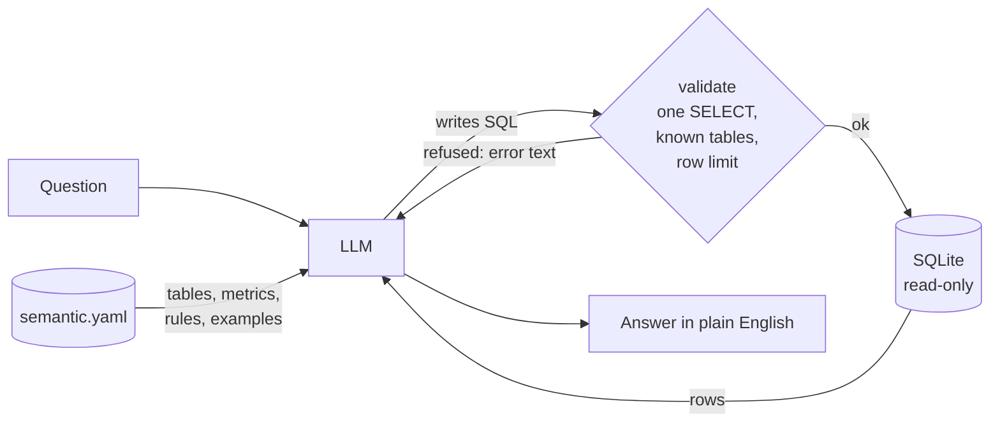

# Text-to-SQL in one file

Text-to-SQL is simpler than it looks. This repo answers plain-English questions about a shop's sales with **97 lines of Python**, one YAML file of business knowledge, and no agent framework, vector database or orchestration layer.


> **Status:** `make test` passes (9 tests), `ruff` is clean, and the three example queries run against the seeded database. The safety gate refuses `DROP` and `sqlite_master`. A **live model session has not been run yet**, so answer quality is unmeasured. All data is synthetic.

## The idea

The model does not know your business. You tell it, in one file, and you check everything it writes.

| Piece | File | Size |
|---|---|---|
| Business knowledge: tables, columns, joins, metrics, rules, example queries | `semantic.yaml` | 57 lines |
| The agent: prompt, safety gate, query runner, tool loop | `agent.py` | 97 lines |
| Fake retail data (deterministic, seed 42) | `seed.py` | 39 lines |
| Safety-gate tests | `tests/test_validate.py` | small |

## How it works



1. `agent.py` turns `semantic.yaml` into text and puts it in the system prompt.
2. The model calls one tool, `run_sql`, with a SQL string.
3. `validate()` parses the SQL with `sqlglot`. It allows only a single `SELECT` on known tables and adds a row limit.
4. The query runs on a connection opened with `mode=ro`.
5. Rows, or an error message, go back to the model. It can fix its own mistake and retry, up to 5 steps.
6. The model answers in plain English, using only numbers from the results.

## Why it is safe enough to try

- **Two layers.** The parser rejects anything but a `SELECT`. Even if that check were bypassed, the database connection cannot write.
- **Allow-list of tables.** `sqlite_master` and unknown tables are refused.
- **Row cap.** Every query gets a limit of 200 rows.
- **Errors are information.** A refused or failed query goes back to the model as text, not as a crash.

## What the knowledge file looks like

```yaml
metrics:
  - name: revenue
    expr: "SUM(order_lines.quantity * products.list_price * (1 - order_lines.discount_pct))"
    description: Net revenue in EUR
examples:
  - question: Revenue by country
    sql: SELECT o.country, ROUND(SUM(...), 2) AS revenue FROM ... GROUP BY o.country ORDER BY revenue DESC
```

Defining a metric once, with a verified example, is what makes answers consistent. To teach the agent something new, edit the YAML, not the code.

## Quickstart

```bash
pip install -r requirements.txt
export OPENAI_API_KEY=...            # any OpenAI-compatible provider works via OPENAI_BASE_URL
python agent.py "Which country has the highest revenue?"
python agent.py                      # prompt loop
make test                            # needs pytest
```

`shop.db` is built on first run from `seed.py`. Configuration is in `.env.example`; real values are never committed.

## What is deliberately left out

No agent framework, no vector store, no chat UI, no caching, no authentication, no tracing. They are useful later, not required to get a correct answer. Add each one when a measured problem asks for it.

## Limitations

- **The gate checks safety, not correctness.** The model can still write a wrong but valid query, for example a join that double counts. The metric definitions and examples reduce this; they do not remove it. Measure it with a golden question set before trusting results.
- It works on a three-table schema. Large schemas need a retrieval step to choose which columns to show the model.
- Dates are text in SQLite; other databases need a different dialect in `sqlglot` and the prompt.
- The default model name is a placeholder you can override with `MODEL`.
- No latency, cost or accuracy numbers have been measured.

## Next steps

- [ ] Run a live session; record real answers and failures.
- [ ] Add a golden question set with expected results and report accuracy.
- [ ] Compare with a version that has no semantic file.
- [ ] Add schema retrieval for larger databases.

See also: [text-to-sql-agent-guardrails](https://github.com/Oroboros26/text-to-sql-agent-guardrails) for a fuller guarded agent with an evaluation set.
